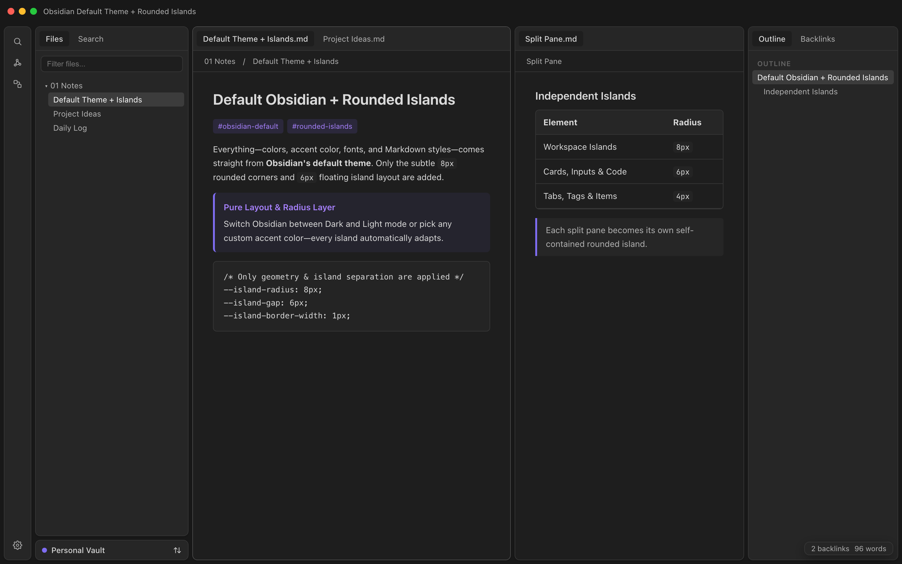
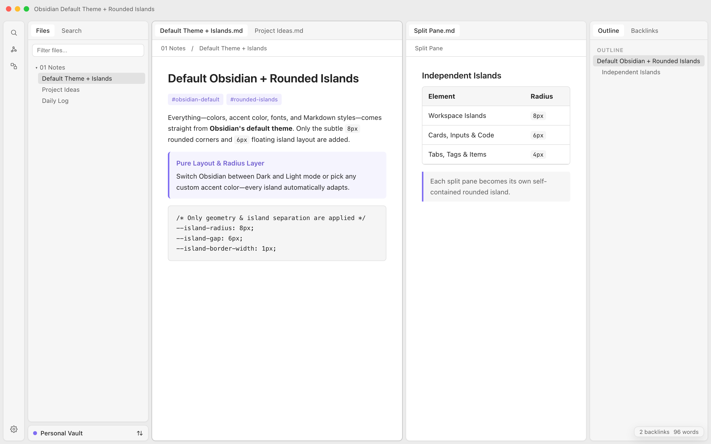

# VS Code Modern Islands (Obsidian Theme)

An Obsidian theme that preserves **100% of Obsidian's default theme** (colors, accent color, typography, and syntax highlighting) while applying **only** VS Code Modern-inspired **minimal subtle rounded corners** (`8px`) and **floating workspace islands** (`6px` gaps, `1px` hairline borders).

## Preview

### Dark Mode (Obsidian Default + Rounded Islands)


### Light Mode (Obsidian Default + Rounded Islands)


## Features

- **100% Native Obsidian Default Theme**: Does not override Obsidian's default Dark/Light colors, your custom accent color, fonts, or Markdown/syntax styling.
- **Floating Workspace Islands**: Left ribbon, left & right sidebars, vault switcher footer, every split editor pane, and the bottom-right status bar become independent rounded islands separated by clean gaps.
- **Minimal Subtle Rounded Corners**: Unified rounding scale (`8px` islands, modals, command palette, menus & popovers; `6px` inputs, buttons, code blocks, callouts & tables; `4px` tabs, tree items, tags & checkboxes).
- **Style Settings Support**: Live sliders for `--island-radius`, `--island-gap`, and `--island-border-width` via the [Style Settings](https://github.com/mgmeyers/obsidian-style-settings) community plugin.

## Installation

### Option 1: Install Script (Recommended)

```bash
# Copy theme files into your vault
./scripts/install.sh /path/to/your/vault

# Or symlink for live editing / development
./scripts/install.sh --symlink /path/to/your/vault
```

Then open Obsidian → **Settings → Appearance → Themes** and select **VS Code Modern Islands**.

### Option 2: Manual Installation

1. Create a folder named `VS Code Modern Islands` inside `<your-vault>/.obsidian/themes/`.
2. Copy `manifest.json` and `theme.css` into that folder.
3. Enable **VS Code Modern Islands** in **Settings → Appearance → Themes**.

## Interactive Preview

You can preview `theme.css` layered over Obsidian's default Light & Dark variables in any browser:

```bash
python3 -m http.server 8765
# Open http://localhost:8765/preview/
```
